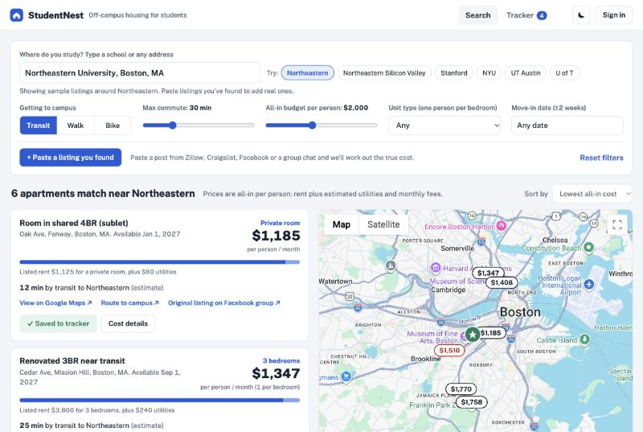
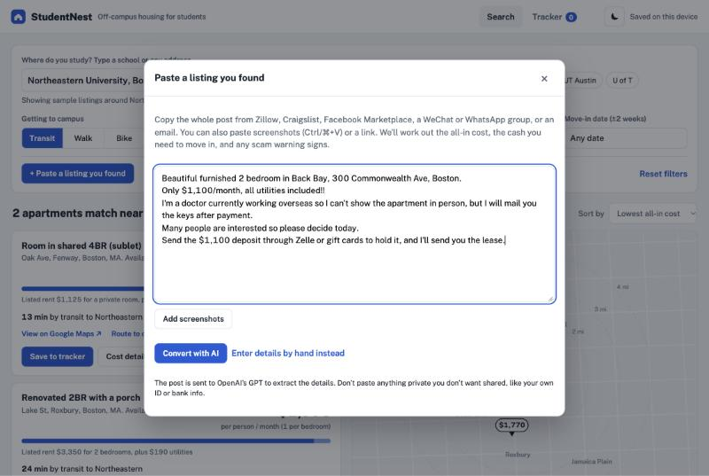
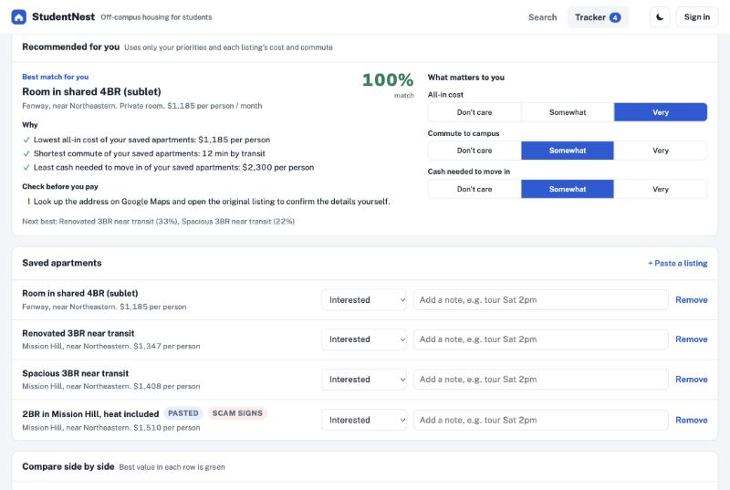
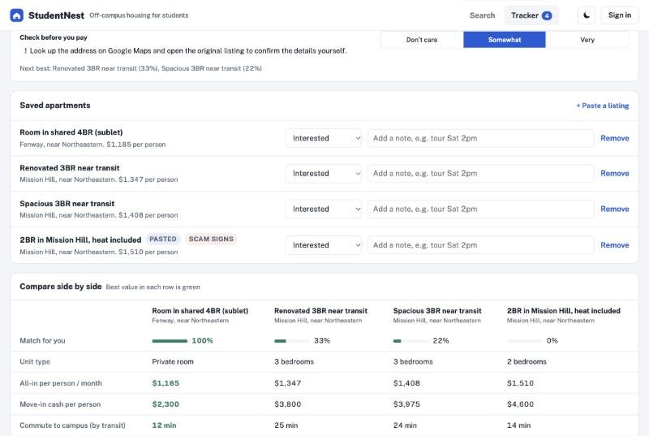
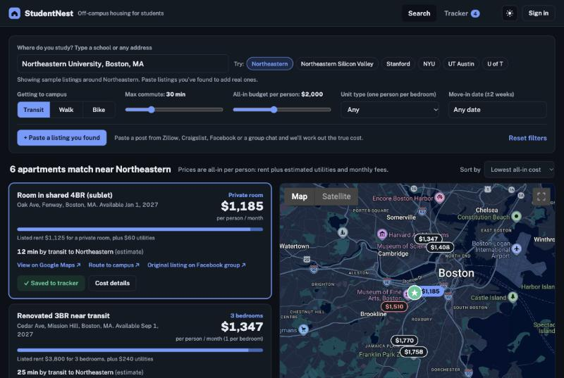

# StudentNest AI

**Live demo: https://studentnest-ai.vercel.app**

## Team Members

| Name | GitHub |
|------|--------|
| Bo Hu | [`BoHu1122`](https://github.com/BoHu1122) |
| Fanchao Yu | [`evelynyu16`](https://github.com/evelynyu16) |
| Na Yin | [`ynbonvayage`](https://github.com/ynbonvayage) |

## Project Description

Finding an off-campus apartment is stressful and time-consuming for many university students. Listings are scattered across many platforms, written in inconsistent formats, and often missing key details such as total cost, lease terms, or commute time. Students new to the city, including transfer and international students who cannot visit in person, also face the risk of rental scams and unfamiliar local rules. Our team is using a human-centered design process to study how students find, compare, and verify apartments, and where that process breaks down.

## Project Status

**This is Phase 1: Research & Planning.** A working prototype is deployed at the link above.

---

## Using StudentNest

### 1. Search around your school

Type your school or any address (or pick one of the quick chips), then set how you get to campus, your maximum commute, your all-in budget per person, unit type and move-in date. Every price shown is **all-in per person**: rent plus estimated utilities and monthly fees. Each listing shows its transit time to campus, and the map shows where it is.



### 2. See the real cost of a listing

Click **Cost details** on any card to see the cash needed to move in (first month, last month, security deposit, broker and application fees) plus tips specific to that listing, such as asking for written approval before paying for a sublet. Click **Save to tracker** to keep it.


### 3. Paste a listing you found anywhere

Click **+ Paste a listing you found** and paste the post text from Zillow, Craigslist, Facebook Marketplace, a WeChat or WhatsApp group, or an email. You can also add screenshots or a link. Click **Convert with AI**.



### 4. Check the AI's result and scam warnings

The AI fills in rent, fees, deposits, move-in date and address. Fields it had to estimate are marked with a yellow edge so you can fix them. If the post shows rental-scam signs (owner abroad, pay before viewing, gift cards or wire transfers, pressure to decide today, rent far below the area), a red warning appears at the top. It also suggests questions to ask before paying. Check every field, then save.


### 5. Track and get a recommendation

Open **Tracker** to see everything you saved. Set what matters to you (all-in cost, commute, cash needed to move in) and StudentNest recommends the best match and explains why. Move each apartment through stages (Interested, Contacted, Toured, Applied) and add notes such as "tour Sat 2pm".



### 6. Compare side by side

Scroll down in Tracker to compare your saved apartments row by row. The best value in each row is green.



### 7. Sign in to keep your list on every device

Click **Sign in** and enter your email to get a sign-in link. Your tracker, notes and pasted listings are then saved to your account; anything saved before signing in moves into it. Pasting with AI and real commute times require signing in.


### 8. Light or dark mode

The sun/moon button in the top right switches themes. The map switches too, and your choice is remembered.



---

## Setting up your own copy

The prototype is a React + TypeScript app (Vite) with three server functions in `api/`. It uses four services; all have free tiers that are enough for this project.

### Step 1: Run it locally

```bash
npm install
cp .env.example .env.local   # fill in the keys you have
npm run dev                  # http://localhost:5173
```

Every key is optional. Whatever is missing falls back to a simpler mode:

| Feature | Needs | Without it |
|---|---|---|
| Sign-in, tracker saved across devices | `VITE_SUPABASE_URL`, `VITE_SUPABASE_ANON_KEY`, `SUPABASE_URL`, `SUPABASE_ANON_KEY` | Tracker is kept in this browser only; no sign-in button |
| Paste a listing → AI converts it | `OPENAI_API_KEY` (optional `OPENAI_MODEL`) | "Enter details by hand" still works |
| Real map | `VITE_GOOGLE_MAPS_KEY` (Maps JavaScript API) | Schematic map |
| Any school/address, real travel times | `GOOGLE_MAPS_SERVER_KEY` (Geocoding API + Routes API) | Built-in list of schools; commute is a distance estimate |
| "Continue with Google" sign-in | `VITE_ENABLE_GOOGLE_SIGNIN=true` and the Google provider on in Supabase | Email-link sign-in only |

Never commit `.env.local` or share the server keys over chat.

### Step 2: Supabase (sign-in and database, free)

1. Create a project at [supabase.com](https://supabase.com). Leave **Enable Data API** on, and turn on **automatic RLS** for new tables.
2. **Project Settings → API Keys**: copy the Project URL and the **publishable** key into `VITE_SUPABASE_URL` / `SUPABASE_URL` and `VITE_SUPABASE_ANON_KEY` / `SUPABASE_ANON_KEY`. The secret key is not needed.
3. **SQL Editor → New query**: paste [`supabase/schema.sql`](supabase/schema.sql) and click **Run**. It creates the `tracker_items` and `profiles` tables with row-level security, so each student only sees their own data.
4. **Authentication → Sign In / Providers**: keep **Email** on.
5. **Authentication → URL Configuration**: set **Site URL** to your deployed URL and add `http://localhost:5173/**` and `https://<your-app>.vercel.app/**` to **Redirect URLs**.

Free projects pause after 7 days without use. Restore them from the Supabase dashboard before a demo.

### Step 3: OpenAI (AI listing parser, pay-as-you-go)

1. At [platform.openai.com](https://platform.openai.com), add credit under **Billing** and leave **auto-reload off** so spending can't exceed the balance.
2. Create a project, then **API keys → Create new secret key** in that project. Put it in `OPENAI_API_KEY`.
3. The default model is `gpt-5.4-mini`, about a cent per listing. Set `OPENAI_MODEL` to use another.

### Step 4: Google Maps (map, geocoding, commute times, free monthly usage)

1. In [Google Cloud Console](https://console.cloud.google.com), create a project and link a billing account.
2. **APIs & Services → Library**: enable **Maps JavaScript API**, **Geocoding API** and **Routes API** (not "Route Optimization API").
3. **Credentials → Create credentials → API key**, twice:
   - **Browser key** → `VITE_GOOGLE_MAPS_KEY`. Application restriction **Websites**: `http://localhost:5173/*` and `https://<your-app>.vercel.app/*`. API restriction: **Maps JavaScript API** only.
   - **Server key** → `GOOGLE_MAPS_SERVER_KEY`. Application restriction **None** (Vercel has no fixed IP). API restriction: **Geocoding API** and **Routes API** only.
4. Protect against surprise bills:
   - **Billing → Budgets & alerts**: a $5 monthly budget alert.
   - **Google Maps Platform → Quotas**: Geocoding API "v3 requests per day" = 500; Routes API "ComputeRouteMatrix per-element quota per day" = 1,000.

### Step 5: Deploy to Vercel (free)

```bash
npx vercel login
npx vercel link
npx vercel deploy --prod
```

Add the same variables under **Vercel → Project → Settings → Environment Variables** (or with `npx vercel env add`). Files in `api/` become serverless functions automatically. Then add the Vercel URL to Supabase's URL Configuration and to the Google browser key's website list (Steps 2 and 4). Run `npx vercel deploy --prod` again after each change.

When Supabase is configured, the `/api` endpoints accept only signed-in users, so the OpenAI and Google keys can't be used by anyone else.

---

## How it's built

- `src/lib/`: cost math, sample listings, scoring for the recommendation, API and Supabase clients
- `src/components/`: Search (filters, cards, map), Tracker (stages, recommendation, side-by-side compare), Paste dialog, Sign-in dialog
- `src/hooks/useTracker.ts`: tracker and priorities, stored locally or in Supabase. Anything saved before sign-in moves into the account on first sign-in
- `src/hooks/useTheme.ts`: light/dark mode, remembered in the browser
- `api/parse-listing.ts`: sends pasted text, screenshots or a link to OpenAI GPT (structured output). Returns rent, fees, deposits, move-in date, scam warning signs and questions to ask. The student checks and edits every field before saving
- `api/geocode.ts`, `api/commute.ts`: Google Geocoding and Routes API (transit times for a weekday morning)

Sample listings around each school are generated for the demo. Listings students paste are real.
