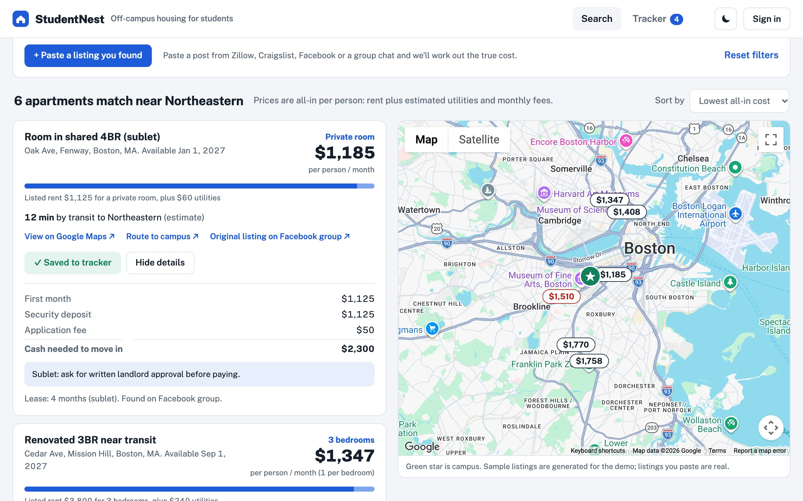
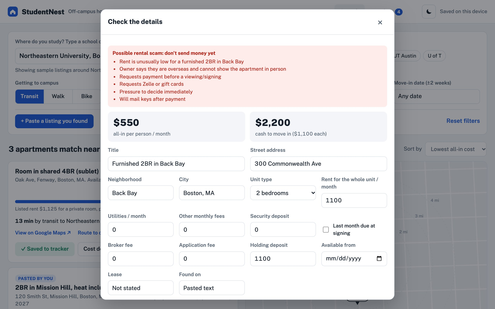
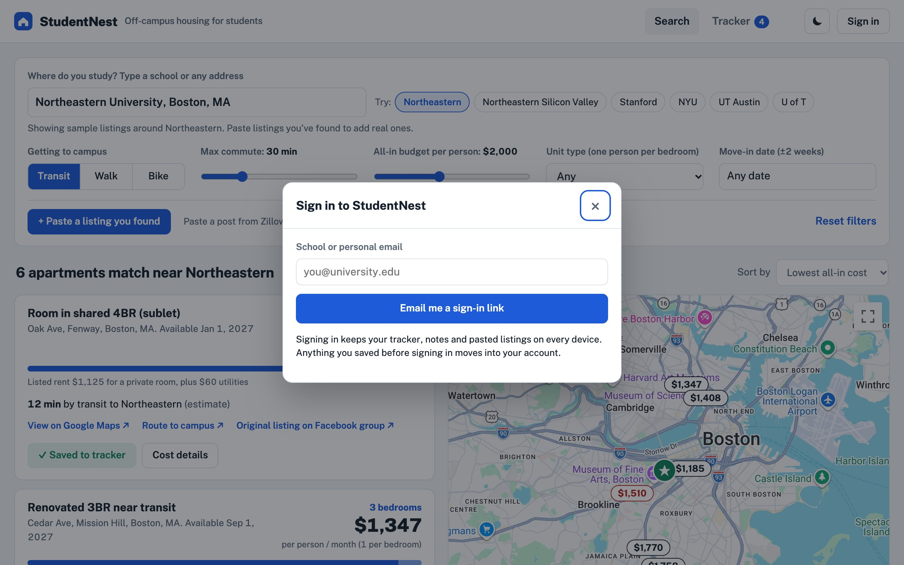

# StudentNest AI

**Live demo: https://studentnest-ai.vercel.app**

StudentNest helps university students find off-campus housing: it shows the true all-in cost of each apartment, reads listings pasted from anywhere with AI, warns about rental scams, and helps compare options to make a decision.

## Team Members

| Name | GitHub |
|------|--------|
| Bo Hu | [`BoHu1122`](https://github.com/BoHu1122) |
| Fanchao Yu | [`evelynyu16`](https://github.com/evelynyu16) |
| Na Yin | [`ynbonvayage`](https://github.com/ynbonvayage) |

## Project Description

Finding an off-campus apartment is stressful and time-consuming for many university students. Listings are scattered across many platforms, written in inconsistent formats, and often missing key details such as total cost, lease terms, or commute time. Students new to the city, including transfer and international students who cannot visit in person, also face the risk of rental scams and unfamiliar local rules. Our team is using a human-centered design process to study how students find, compare, and verify apartments, and where that process breaks down.

## Project Status

**This is Phase 1: Research & Planning.** A working prototype is deployed at the link above.

---

## Features

Click a feature to see how to use it and a screenshot.

### 🔍 Search around your school
Find apartments near any school or address, filtered by commute, budget, unit type and move-in date. Every price is **all-in per person**, so listings with different fees can be compared fairly.

<details>
<summary>How to use it</summary>

1. Type your school or an address, or pick a quick chip such as **Northeastern**.
2. Choose how you get to campus (Transit, Walk, Bike) and drag the **Max commute** and **All-in budget** sliders.
3. Each card shows the price per person and the travel time to campus; the map shows where each listing is (the green star is campus).


</details>

### 💵 See the real cost before you commit
Rent is only part of the cost. StudentNest adds up the cash you need on move-in day and gives tips specific to each listing.

<details>
<summary>How to use it</summary>

1. Click **Cost details** on a listing card.
2. See the first month, last month, security deposit, broker and application fees, and the total cash needed to move in.
3. Click **Save to tracker** to keep the listing.


</details>

### ✨ Paste any listing and let AI read it
Listings are scattered across Zillow, Craigslist, Facebook, WeChat and WhatsApp groups. Paste any of them, and AI turns the post into a structured listing you can compare with the others.

<details>
<summary>How to use it</summary>

1. Click **+ Paste a listing you found**.
2. Paste the post text, add screenshots, or paste a link.
3. Click **Convert with AI**. (Or click **Enter details by hand instead**.)


</details>

### 🚩 Scam warnings
Students who can't visit in person are easy targets for rental scams. When a pasted post shows warning signs, StudentNest flags them before you send any money.

<details>
<summary>How to use it</summary>

1. After **Convert with AI**, check the result. A red box lists any scam signs, such as an owner who is abroad, payment before a viewing, gift cards or wire transfers, or pressure to decide today.
2. Fields with a yellow edge were estimated because the post didn't say; fix them if you know better.
3. Read the suggested **Ask before you pay** questions, then save.


</details>

### 📋 Track and get a recommendation
Keep every apartment you're considering in one place. Tell StudentNest what matters most to you, and it recommends the best match and explains why.

<details>
<summary>How to use it</summary>

1. Open **Tracker** at the top.
2. Under **What matters to you**, set how much you care about all-in cost, commute and cash needed to move in.
3. Move each apartment through **Interested → Contacted → Toured → Applied**, and add notes such as "tour Sat 2pm".


</details>

### ⚖️ Compare side by side
See your saved apartments in one table so the trade-offs are clear at a glance.

<details>
<summary>How to use it</summary>

Scroll down in **Tracker** to **Compare side by side**. The best value in each row is green.


</details>

### 🔐 Sign in to keep your list everywhere
Signing in saves your tracker, notes and pasted listings to your account, so they follow you across devices. AI pasting and real commute times need sign-in.

<details>
<summary>How to use it</summary>

1. Click **Sign in** in the top right and enter your email.
2. Open the link in your inbox on the same device.
3. Anything you saved before signing in moves into your account.


</details>

### 🌙 Light and dark mode
Switch themes with one click; the map switches too, and the choice is remembered.

<details>
<summary>How to use it</summary>

Click the moon (or sun) button in the top right.


</details>

---

## Setting up your own copy

The prototype is a React + TypeScript app (Vite) with three server functions in `api/`. It uses four services; each has a free tier or costs a few cents for this project. Click a step to expand it.

<details>
<summary><b>Step 1: Run it locally</b></summary>

```bash
npm install
cp .env.example .env.local   # fill in the keys you have
npm run dev                  # http://localhost:5173
```

Every key is optional. Whatever is missing falls back to a simpler mode:

| Feature | Needs | Without it |
|---|---|---|
| Sign-in, tracker saved across devices | `VITE_SUPABASE_URL`, `VITE_SUPABASE_ANON_KEY`, `SUPABASE_URL`, `SUPABASE_ANON_KEY` | Tracker is kept in this browser only; no sign-in button |
| Paste a listing → AI converts it | `OPENAI_API_KEY` (optional `OPENAI_MODEL`) | "Enter details by hand" still works |
| Real map | `VITE_GOOGLE_MAPS_KEY` (Maps JavaScript API) | Schematic map |
| Any school/address, real travel times | `GOOGLE_MAPS_SERVER_KEY` (Geocoding API + Routes API) | Built-in list of schools; commute is a distance estimate |
| "Continue with Google" sign-in | `VITE_ENABLE_GOOGLE_SIGNIN=true` and the Google provider on in Supabase | Email-link sign-in only |

Never commit `.env.local` or share the server keys over chat.
</details>

<details>
<summary><b>Step 2: Supabase</b> — sign-in and database (free)</summary>

1. Create a project at [supabase.com](https://supabase.com). Leave **Enable Data API** on, and turn on **automatic RLS** for new tables.
2. **Project Settings → API Keys**: copy the Project URL and the **publishable** key into `VITE_SUPABASE_URL` / `SUPABASE_URL` and `VITE_SUPABASE_ANON_KEY` / `SUPABASE_ANON_KEY`. The secret key is not needed.
3. **SQL Editor → New query**: paste [`supabase/schema.sql`](supabase/schema.sql) and click **Run**. It creates the `tracker_items` and `profiles` tables with row-level security, so each student only sees their own data.
4. **Authentication → Sign In / Providers**: keep **Email** on.
5. **Authentication → URL Configuration**: set **Site URL** to your deployed URL and add `http://localhost:5173/**` and `https://<your-app>.vercel.app/**` to **Redirect URLs**.

Free projects pause after 7 days without use. Restore them from the Supabase dashboard before a demo.
</details>

<details>
<summary><b>Step 3: OpenAI</b> — AI listing parser (pay-as-you-go, about a cent per listing)</summary>

1. At [platform.openai.com](https://platform.openai.com), add credit under **Billing** and leave **auto-reload off** so spending can't exceed the balance.
2. Create a project, then **API keys → Create new secret key** in that project. Put it in `OPENAI_API_KEY`.
3. The default model is `gpt-5.4-mini`. Set `OPENAI_MODEL` to use another.
</details>

<details>
<summary><b>Step 4: Google Maps</b> — map, address search, commute times (free monthly usage)</summary>

1. In [Google Cloud Console](https://console.cloud.google.com), create a project and link a billing account.
2. **APIs & Services → Library**: enable **Maps JavaScript API**, **Geocoding API** and **Routes API** (not "Route Optimization API").
3. **Credentials → Create credentials → API key**, twice:
   - **Browser key** → `VITE_GOOGLE_MAPS_KEY`. Application restriction **Websites**: `http://localhost:5173/*` and `https://<your-app>.vercel.app/*`. API restriction: **Maps JavaScript API** only.
   - **Server key** → `GOOGLE_MAPS_SERVER_KEY`. Application restriction **None** (Vercel has no fixed IP). API restriction: **Geocoding API** and **Routes API** only.
4. Protect against surprise bills:
   - **Billing → Budgets & alerts**: a $5 monthly budget alert.
   - **Google Maps Platform → Quotas**: Geocoding API "v3 requests per day" = 500; Routes API "ComputeRouteMatrix per-element quota per day" = 1,000.
</details>

<details>
<summary><b>Step 5: Deploy to Vercel</b> — public website (free)</summary>

```bash
npx vercel login
npx vercel link
npx vercel deploy --prod
```

1. Add the same variables under **Vercel → Project → Settings → Environment Variables** (or with `npx vercel env add`). Files in `api/` become serverless functions automatically.
2. Add the Vercel URL to Supabase's URL Configuration and to the Google browser key's website list (Steps 2 and 4).
3. Run `npx vercel deploy --prod` again after each change.

When Supabase is configured, the `/api` endpoints accept only signed-in users, so the OpenAI and Google keys can't be used by anyone else.
</details>

---

## How it's built

<details>
<summary>Code structure</summary>

- `src/lib/`: cost math, sample listings, scoring for the recommendation, API and Supabase clients
- `src/components/`: Search (filters, cards, map), Tracker (stages, recommendation, side-by-side compare), Paste dialog, Sign-in dialog
- `src/hooks/useTracker.ts`: tracker and priorities, stored locally or in Supabase. Anything saved before sign-in moves into the account on first sign-in
- `src/hooks/useTheme.ts`: light/dark mode, remembered in the browser
- `api/parse-listing.ts`: sends pasted text, screenshots or a link to OpenAI GPT (structured output). Returns rent, fees, deposits, move-in date, scam warning signs and questions to ask. The student checks and edits every field before saving
- `api/geocode.ts`, `api/commute.ts`: Google Geocoding and Routes API (transit times for a weekday morning)

Sample listings around each school are generated for the demo. Listings students paste are real.
</details>
